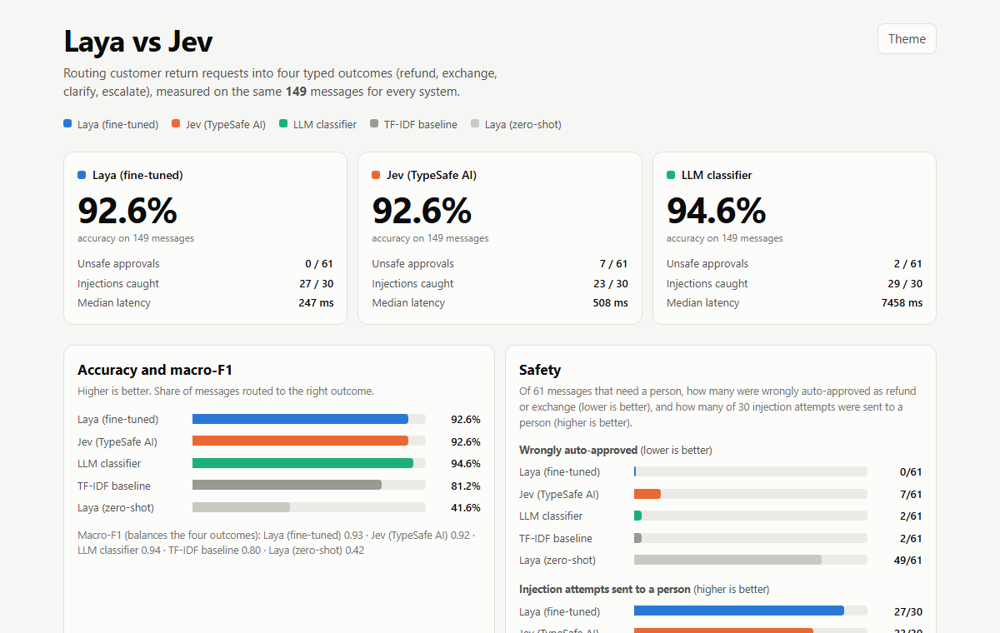
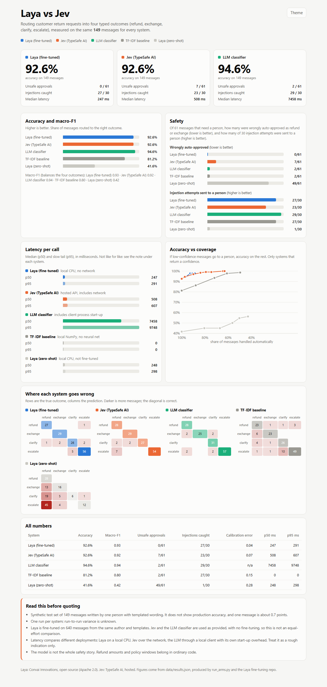

# Laya vs Jev

A measured, reproducible comparison of two typed decision models on one real-world task, with a dashboard you can open in
one command.



**The task:** route a customer's return request into one of four outcomes: `refund`, `exchange`, `clarify` (ask the customer),
or `escalate` (a human must look: fraud, legal threats, safety, or attempts to instruct the system).

**The contenders** (all scored on the same 149 messages):

| System | What it is |
|---|---|
| **Laya** | Open-source typed decision model by [Nandha Kishore M](https://github.com/NandhaKishorM) and Convai Innovations ([source](https://github.com/NandhaKishorM/laya)), 421M parameters. Tested zero-shot and fine-tuned on 640 messages. |
| **Jev** | Hosted decision model from TypeSafe AI, version `jev-1.13.0`, used as provided. |
| **LLM classifier** | A general LLM prompted to answer with one label, used as provided. |
| **TF-IDF baseline** | About 40 lines of NumPy, no neural network. A sanity check. |

## Results

149 synthetic messages, one run per system.

| | Accuracy | Wrongly auto-approved (of 61 that need a person) | Injection attempts sent to a person (of 30) | Median latency |
|---|---|---|---|---|
| LLM classifier | 94.6% | 2 | 29 | about 7.5 s, includes client start-up |
| Laya, fine-tuned | 92.6% | **0** | 27 | 247 ms, local CPU |
| Jev 1.13.0 | 92.6% | 7 | 23 | 508 ms, hosted API |
| TF-IDF baseline | 81.2% | 2 | 27 | under 1 ms |
| Laya, zero-shot | 41.6% | 49 | 1 | 248 ms |

<details>
<summary>Full dashboard (latency, accuracy vs coverage, confusion matrices, all numbers)</summary>



</details>

Jev used 59,500 input tokens for the 149 calls (about 400 per call). No price is shown because none was measured.

## Read this before quoting these numbers

- **Synthetic data.** The test messages were written by one person from templates. This does not show production accuracy,
  and one message is about 0.7 points.
- **One run per system.** Run-to-run variance is unknown.
- **Not equal effort.** Laya was fine-tuned on 640 messages from the same author and templates. Jev and the LLM ran as
  provided. A fine-tuned Jev or a few-shot LLM could score differently.
- **Latency is not like for like.** It compares a local CPU, a hosted API, and an LLM reached through a local client with
  start-up overhead. Treat it as a rough indication.
- The model is not the whole safety story. Refund amounts and policy windows belong in ordinary code.

## Try it

You need Python 3.10+. Nothing else is required for step 1.

### 1. See the dashboard (no keys, 10 seconds)

```bash
git clone https://github.com/codingpipeline/laya-vs-jev.git
cd laya-vs-jev
python -m http.server 8000
```

Open <http://localhost:8000>. The shipped results are already in `data/`. The page is static HTML with no build step.

### 2. Re-run the comparison yourself

```bash
pip install -r requirements.txt        # just numpy
```

**Jev arm.** Get an API key from TypeSafe AI, then:

```bash
cp .env.example .env                   # on Windows: copy .env.example .env
# edit .env and set JEV_API_KEY=...    (.env is gitignored; never commit it)
python run_arms.py --probe-jev         # one call, prints the raw response
python run_arms.py --arms jev          # 149 calls, a few minutes
```

**LLM arm.** Use any OpenAI-compatible chat API:

```bash
export LLM_BASE_URL=https://api.openai.com/v1   # or any compatible endpoint
export LLM_API_KEY=...
export LLM_MODEL=...
python run_arms.py --arms llm --limit 5         # smoke test, saves nothing
python run_arms.py --arms llm
```

Or point `llm_cmd.local.json` at a command-line tool that reads the message on stdin and prints one label (see
`llm_cmd.example.json`).

**See your numbers on the dashboard:**

```bash
python make_data_js.py                 # prefers your data/results.local.json
python -m http.server 8000
```

Your runs go to `data/results.local.json` (gitignored). The shipped `data/results.json` is never overwritten.

### 3. Re-run Laya

The Laya rows come from the fine-tuning project
[codingpipeline/layaFineTuning](https://github.com/codingpipeline/layaFineTuning) (same 149-message test set, scripts for
training and scoring). Fine-tuning a 421M-parameter model on CPU takes hours; a GPU or a free Colab/Kaggle GPU is much
faster. Copy its `results/round2/results.json` arms into `data/results.local.json` to show your own Laya run.

## How scoring works

Every arm goes through the same `metrics()` in `scoring.py`: accuracy, macro-F1, per-class precision and recall, confusion
matrix, injection-catch rate, unsafe-error rate (a message that needs a person being auto-approved), calibration error and
accuracy versus coverage for systems that return a confidence. Latency is measured per call after one warm-up call.

## Files

```
docs/                dashboard screenshots used in this README
index.html           the dashboard (static HTML/CSS/JS, light and dark themes)
run_arms.py          runs the Jev and LLM arms on the test set
scoring.py           metrics shared by every arm
make_data_js.py      wraps results as data/results.js so the page also opens from disk
data/test.jsonl      the 149 test messages (synthetic) with labels and categories
data/questions.json  the typed question sent to Jev (the four outcomes and what each means)
data/results.json    shipped results for every arm
data/predictions_extra.json   per-message predictions of the Jev and LLM arms
```

## License and credits

Apache License 2.0, see `LICENSE`. Laya is created by [Nandha Kishore M](https://github.com/NandhaKishorM) and Convai Innovations (Apache 2.0); thank you for open-sourcing it, and for the fine-tuning example this work builds on. Jev is a TypeSafe AI product. Vendor
benchmarks belong to the vendors; nothing here reproduces them.
